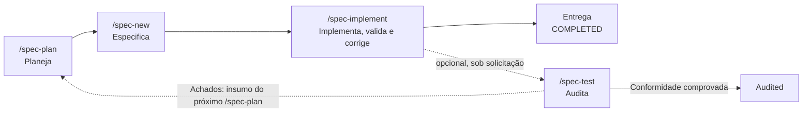

<div align="center">

**🌐 Idioma:** Português | [English](docs/i18n/README.en.md) | [Español](docs/i18n/README.es.md) | [简体中文](docs/i18n/README.zh-Hans.md) | [हिन्दी](docs/i18n/README.hi.md)

</div>

<br/>

<div align="center">
<br/>
<br/>
<p align="center">
  
</p>
<h1>DsCode</h1>

[![][github-license-shield]][github-license-link]
[![][github-stars-shield]][github-stars-link]

**Assistente de programação no terminal, com suporte a múltiplos modelos e ferramentas de desenvolvimento orientado a especificações.**

<br/>
</div>

O **DsCode** é um assistente de programação que roda no terminal. Ele integra modelos de diferentes provedores — como DeepSeek, OpenAI, Anthropic, Gemini, GLM, Muse Spark e modelos locais — para analisar, revisar e escrever código no projeto. Os modelos disponíveis dependem da configuração e da versão instalada.

O DsCode oferece ferramentas de planejamento orientado a especificações (SDD), implementação, validação e auditoria. A arquitetura SDD v21 integra essas capacidades em **um ciclo único de engenharia**, no qual erros de compilação e testes retornam ao mesmo executor até a correção, dentro de limites seguros. A certificação permanece determinística e depende de evidências reais; o agente não aprova suas próprias alterações. O motor v21 está ativo; a homologação operacional de ponta a ponta em `/spec-pipe` real foi executada em 04/11/2026 com as specs 3900 e 3910, ambas encerradas em `implemented`. A certificação `audited` não foi executada nessas specs: ela continua sendo um ato explícito de auditoria.

---

## Principais capacidades



> **Delivery-first:** o `/spec-pipe` executa `spec-new → spec-implement` e entrega o trabalho efetivo. Ele **não** roda `/spec-test` automaticamente e **não** exige `audited` para concluir. A auditoria é um ato explícito do usuário, rigoroso e independente: ela diagnostica a implementação e só concede `audited` com conformidade comprovada. Consulte [o contrato v21](sdd-contrato/sdd-fluxo.md). Não confunda código escrito com spec certificada.

**Política de qualidade:** continuar implementação e correção quando houver trabalho seguro; pausar somente quando recursos ou segurança exigirem; declarar `audited` apenas com aceitação verificada. Falhas reais não são ocultadas.

| Capacidade              | O que faz                                                                                              | Por que nenhum outro tem                                                                                  |
| ----------------------- | ------------------------------------------------------------------------------------------------------ | --------------------------------------------------------------------------------------------------------- |
| **Pipeline SDD**        | Planejar → especificar → implementar; auditar sob solicitação                                          | Entrega primeiro: um ciclo de implementação e correção, com auditoria baseada em provas quando solicitada |
| **Multi-provedor**      | DeepSeek V4/V4.1, OpenAI GPT, Anthropic Claude, Google Gemini, Z.AI GLM, Muse Spark, Ollama/vLLM local | Troque de provedor sem alterar uma linha de configuração; chaves por projeto, migração automática         |
| **Stack-agnostic**      | TypeScript, .NET, Python e mais pelo mesmo caminho de validação                                        | O gate não julga sua linguagem — valida o documento e roda seus testes                                    |
| **Skills como agentes** | Subagentes isolados com modelo, tools e thinking próprios                                              | Cada skill roda em sandbox — não polui o contexto principal                                               |
| **MCP nativo**          | Conecte bancos, navegadores e APIs externas                                                            | Integrado nas 3 camadas: skills, specs e TUI                                                              |
| **Steering**            | Regras persistentes que a IA segue em todas as sessões                                                 | Controle granular: adicione, liste, altere e remova regras por posição                                    |

---

## Como o SDD do DsCode trabalha

O SDD do DsCode existe para **entregar software**, não para colecionar formalidades. Ele planeja o necessário, implementa, valida o que é proporcional e encerra com um resultado claro — mesmo quando sobram pendências.

**NONSTOP é o comportamento normal.** Um teste que falhou, um critério textual que não foi encontrado ou um documento que divergiu da implementação não interrompem o trabalho por si só: geram diagnóstico, uma correção limitada quando é acionável, e continuam. Parar é reservado a impedimentos reais — segurança, permissão, integridade, cancelamento explícito do usuário ou impossibilidade de executar com segurança.

**Validação proporcional.** Durante a implementação o agente faz checagens locais e roda os testes ligados à mudança. Nenhuma invocação de implementação — `/spec-pipe` ou `/spec-implement` direto — executa o bundle de qualidade, a suíte direcionada ou os comandos declarados por tarefa como fechamento: o fato registrado é `not-applicable`, nada é adiado e nada é recuperado ao encerrar (ADR-032/ADR-039). Esses comandos continuam disponíveis como ação explícita do desenvolvedor (CI, hook de push) e dentro do `/spec-test`. Para revisar e corrigir o que já foi entregue existe `/spec-stabilize`: ele procura defeitos reais, corrige e reavalia, e nunca certifica.

**Três resultados terminais** para `/spec-pipe`:

| Resultado                 | O que significa                                                                                   |
| ------------------------- | ------------------------------------------------------------------------------------------------- |
| `COMPLETED`               | Todas as tarefas implementadas e persistidas, sem pendência registrada                            |
| `COMPLETED_WITH_WARNINGS` | Trabalho entregue, com pendências, verificações omitidas ou tarefas pendentes claramente listadas |
| `BLOCKED`                 | Impedimento obrigatório — segurança, integridade, permissão, cancelamento ou runtime inutilizável |

Nenhum dos três depende de `audited`: o resultado descreve a **implementação**. O `/spec-pipe` executa `spec-new → spec-implement` e **entrega**; ele não roda `/spec-test` automaticamente. Quando quiser a auditoria rigorosa, rode `/spec-test <n>`: ele é a única autoridade que concede `audited`, e só com conformidade comprovada; quando encontra problemas, preserva `implemented` e grava um relatório que o `/spec-plan` pode consumir.

**O pipe não gasta tempo tentando se certificar.** `/spec-pipe` não executa o bundle de qualidade, a suíte direcionada nem os comandos de validação declarados por tarefa: nada é adiado, nada precisa ser recuperado ao encerrar, e o fato registrado é `not-applicable`. Critérios textuais, obrigações não comprovadas e divergência documental entram no relatório como pendências nomeadas e não vetam a entrega nem reabrem tarefa concluída. `/spec-test` mantém a auditoria rigorosa; ele não corrige código nem reabre tarefas, e não executá-lo nunca é apresentado como aprovação.

**Política única de implementação.** `/spec-pipe` e `/spec-implement` direto entregam sob a mesma política: sem veto funcional, sem certificação automática, sem bundle de qualidade como condição de avanço. A invocação escolhe orquestração (o pipe roda também o `spec-new`), nunca rigor — mesmos executor, mesma autoridade de selagem e mesmo estado durável. O rigor pertence ao `/spec-test`, que é a autoridade exclusiva de `audited` e roda apenas quando solicitado.

**Agnóstico de stack.** Prettier, ESLint, TypeScript e npm não são requisitos universais: os validadores são escolhidos pela stack realmente detectada. Projetos .NET, Java, Python, Go, Rust, Delphi e outros seguem o mesmo caminho.

**Estado de implantação.** O motor está ativo e homologado nos gates determinísticos (`check`, `build` e suíte afetada). A homologação operacional em `/spec-pipe` real foi executada em 04/11/2026 com as specs 3900 e 3910, ambas encerradas em `implemented`; a entrega não concede `audited`, e a certificação permanece uma auditoria explícita (`/spec-test`), não executada nessas specs. Contrato v20 parseável continua suportado; o contrato v21 ativo é declarado em modo `v21-guidance`. Detalhe normativo em [sdd-base.txt](sdd-contrato/sdd-base.txt) e [sdd-fluxo.md](sdd-contrato/sdd-fluxo.md).

---

## Instale em 30 segundos

Baixe o binário na **[página de releases](https://github.com/andrelncampos/dscode-public/releases)**. O `package.json` do snapshot examinado declara **[Node.js 24+](https://nodejs.org)**. A homologação-alvo da reforma é **Node.js 26**, mas a alteração do requisito mínimo depende de decisão e validação separadas.

| Sistema       | Arquivo                          |
| ------------- | -------------------------------- |
| Windows (x64) | `dscode-vX.Y.Z-windows-x64.zip`  |
| Linux (x64)   | `dscode-vX.Y.Z-linux-x64.tar.gz` |

Extraia e execute `./dscode`. O DsCode verifica atualizações automaticamente ao iniciar.

---

## Primeiro uso

### 1. Configure sua chave

Rode `dscode` dentro do projeto e use `/model-add`. O wizard testa o modelo e grava a credencial **cifrada** em `.dscode/settings.json` — nunca em texto puro.

O arquivo é sempre do projeto; não existe camada global:

```json
{
  "model": "deepseek-flash",
  "modelInstance": "minha-instancia",
  "modelInstances": {
    "minha-instancia": {
      "name": "minha-instancia",
      "modelId": "deepseek-flash",
      "provider": "deepseek",
      "apiKey": "aes256:...",
      "apiKeyEncrypted": true,
      "priority": 1
    }
  }
}
```

Sem modelo configurado, o DsCode abre normalmente e mostra um aviso persistente guiando para `/model-add`. Chaves ausentes usam o default.

### 2. Abra seu projeto e inicie

```bash
cd /caminho/do/seu/projeto
dscode
```

### 3. Faça o tour interativo

Digite `/quickstart` para um tour de 5 minutos. O tour apresenta os comandos e um projeto de exemplo. A conclusão automática das specs depende do comportamento da versão instalada.

Ou execute `dscode --quickstart` para pular direto para o tour.

---

## Configuração

O `settings.json` é **esparso**: só o que você declarar existe; todo o resto usa o default. Ele fica em `.dscode/settings.json`, é ignorado pelo Git e não pode ser alterado por um turno da IA.

| Chave                      | Para que serve                                          | Exemplo                               |
| -------------------------- | ------------------------------------------------------- | ------------------------------------- |
| `model` / `modelInstance`  | Modelo ativo e instância fixada                         | `"deepseek-flash"`                    |
| `modelInstances`           | Credenciais cifradas, provider e prioridade de failover | veja acima                            |
| `maxTokens`                | Teto de tokens de saída                                 | `128000`                              |
| `reasoningEffort`          | Profundidade de raciocínio                              | `"max"`                               |
| `permissions`              | `allow` / `deny` / `ask` / `defaultMode` por escopo     | `{"deny":["mutate-git-log"]}`         |
| `trust.tools`              | Aprovação persistente de uma ferramenta                 | `{"bash":{"approved":true}}`          |
| `trustedReadRoots`         | Diretórios externos somente leitura                     | `["/srv/docs"]`                       |
| `mcpServers`               | Servidores MCP                                          | veja [docs/mcp.md](docs/mcp.md)       |
| `memory`                   | Retenção e limites do histórico                         | `{"recentTurns":10}`                  |
| `budget`                   | Alerta de custo diário/mensal (não bloqueia)            | `{"dailyLimit":5}`                    |
| `sdd.profile`              | Perfil de rotas técnicas do SDD (sem critério de preço) | `"economic"`                          |
| `sdd.validationExecution`  | Autoriza validação no host                              | `{"allowTrustedLocalExecution":true}` |
| `sdd.autonomousCorrection` | Correção autônoma no `/spec-pipe`                       | `true`                                |
| `cacheMode`                | Consciência de cache de prefixo                         | `"strict"`                            |
| `terminalTitleTemplate`    | Título do terminal                                      | `"{{cwd}}"`                           |
| `locale`                   | Idioma da interface                                     | `"pt"`                                |

### Política de execução

O DsCode é **AI-first, capability-first, cache-first e financeiramente
independente**: preços, tarifas e orçamentos são informação para o humano e
nunca selecionam, limitam, degradam, reordenam ou interrompem uma execução.
Veja [docs/execution-policy.md](docs/execution-policy.md).

**Referência completa:** [docs/configuration.md](docs/configuration.md) — tipo, default e efeito das 77 chaves, os sub-schemas (`modelInstances`, `modelPricing`, `mcpServers`, `engineEscalation`, `sdd.validationExecution`), precedência e receitas. As chaves menos usadas no dia a dia (flags `openai*`, governança SDD, custo, memória detalhada, MCP) ficam lá, não aqui.

---

## Exemplos do que você pode fazer

| Tarefa                  | Digite no prompt                                                      |
| ----------------------- | --------------------------------------------------------------------- |
| **Entender um projeto** | "Explique a arquitetura deste projeto em 3 frases."                   |
| **Revisar código**      | "Revise as alterações do último commit antes de eu fazer push."       |
| **Implementar feature** | "Adicione validação de email ao formulário em `src/form.ts`."         |
| **Refatorar**           | "Simplifique a função `processData()` sem mudar o comportamento."     |
| **Investigar bug**      | "Analise este stack trace e encontre a causa."                        |
| **Criar testes**        | "Crie testes unitários para `validateUser()` em `src/validators.ts`." |
| **Planejar features**   | `/spec-plan` — descreva o que quer e a IA cria specs completas.       |
| **Criar regras**        | `/steering-add sempre use português para responder`                   |

---

## Comandos essenciais

Digite `/` no prompt para ver o menu completo. Aqui estão os que você mais vai usar:

| Comando                                     | Descrição                                                                                               |
| ------------------------------------------- | ------------------------------------------------------------------------------------------------------- |
| `/new`                                      | Nova conversa — zera o contexto                                                                         |
| `/model`                                    | Trocar entre 44 modelos (DeepSeek, OpenAI, Anthropic, Gemini, GLM, Muse Spark, locais)                  |
| `/model-add`                                | Cadastrar modelo pelo wizard unificado (testa antes de salvar)                                          |
| `/quickstart`                               | Tour interativo de 5 minutos pelo pipeline SDD                                                          |
| `/spec-plan`                                | Planejar novas funcionalidades com specs                                                                |
| `/spec-pipe <n>`                            | Entrega SDD: new → implement (sem certificação automática)                                              |
| [`/spec-test`](docs/spec-test.md)           | Auditoria diagnóstica independente de uma spec; concede `audited` só com conformidade comprovada        |
| [`/spec-stabilize`](docs/spec-stabilize.md) | Revisa a implementação entregue, corrige defeitos reais e reavalia até estabilizar; **nunca certifica** |
| `/init`                                     | Criar `AGENTS.md` com instruções para a IA                                                              |
| `/steering-add`                             | Adicionar regra que a IA segue em todas as sessões                                                      |
| `/budget`                                   | Ver custo acumulado do projeto por modelo e timezone                                                    |
| `/context`                                  | Ver tokens, custo e cache da sessão                                                                     |
| `/docs`                                     | Consultar documentação técnica atualizada (Exa/Google)                                                  |
| `/sdd`                                      | Configurar o pipeline SDD (depth, cascade) sem editar JSON                                              |
| `/help`                                     | Lista completa de comandos e atalhos                                                                    |

> 📋 [Lista completa dos 52 comandos](https://github.com/andrelncampos/dscode-public#todos-os-comandos-slash) — incluindo gestão de modelos, notas, MCP e skills.

---

## Skills e agentes autônomos

Skills são guias em Markdown que ensinam a IA a trabalhar de um jeito específico. O DsCode carrega skills de 3 fontes:

| Local                              | Uso                                                                                                                          |
| ---------------------------------- | ---------------------------------------------------------------------------------------------------------------------------- |
| `templates/skills/` (built-in)     | 6 skills embutidas — 3 carregadas sempre (`karpathy-guidelines`, `project-structure`, `sdd-workflow`); as demais sob demanda |
| `./.dscode/skills/<nome>/SKILL.md` | Skills do projeto (maior precedência)                                                                                        |
| `./.agents/skills/<nome>/SKILL.md` | Skills do projeto (compatibilidade)                                                                                          |

Skills podem rodar como **agentes autônomos** (`mode: agent`) — cada um com seu próprio modelo, ferramentas e thinking, executando em sandbox sem poluir o contexto principal.

```yaml
# Exemplo: .agents/skills/reviewer/SKILL.md
name: reviewer
description: Revisa código em busca de bugs
mode: agent
model: deepseek-flash
tools: [read, grep, glob, bash]
```

---

## Segurança

| Prática                                   | Por quê                                                       |
| ----------------------------------------- | ------------------------------------------------------------- |
| **Revise comandos antes de permitir**     | A IA pode sugerir `rm`, `sudo` ou acesso à rede               |
| **Faça commit antes de tarefas grandes**  | `git reset --hard` desfaz tudo se algo der errado             |
| **Revise os diffs**                       | O DsCode mostra cada alteração — a IA pode errar              |
| **Nunca comite `settings.json`**          | Contém sua chave de API (o `.gitignore` já exclui)            |
| **Use branch separada para experimentos** | `git checkout -b experimento-ia` antes de mudanças arriscadas |

---

## Licença e origem

**DsCode é distribuído sob a licença MIT.** Os binários e demais artefatos públicos podem ser usados, copiados, redistribuídos, modificados, sublicenciados e vendidos sem cobrança de royalties — para uso pessoal, acadêmico, profissional ou comercial.

DsCode é um software de código-fonte fechado com distribuições executáveis disponibilizadas sob a licença MIT. O código-fonte das modificações específicas do DsCode não integra a distribuição pública. Por esse motivo, o DsCode não é apresentado como software de código aberto.

**Permissões da MIT (binários distribuídos):**

- ✅ Uso pessoal, acadêmico, profissional e comercial
- ✅ Redistribuição e espelhamento
- ✅ Sublicenciamento e venda
- ✅ Inclusão em produtos e artefatos científicos
- ✅ Benchmarking e publicação de resultados
- ✅ Modificação do artefato distribuído, quando tecnicamente possível

Este projeto deriva de [DeepCode (lessweb/deepcode-cli)](https://github.com/lessweb/deepcode-cli), originalmente licenciado sob MIT. O aviso de copyright original é preservado em [LICENSE](LICENSE) e [NOTICE](NOTICE). Consulte [THIRD_PARTY_NOTICES.md](THIRD_PARTY_NOTICES.md) para a relação completa de componentes e licenças.

---

## Canais oficiais

| Canal        | Link                                                                                                       |
| ------------ | ---------------------------------------------------------------------------------------------------------- |
| **GitHub**   | [github.com/andrelncampos/dscode-public](https://github.com/andrelncampos/dscode-public)                                 |
| **Releases** | [github.com/andrelncampos/dscode-public/releases](https://github.com/andrelncampos/dscode-public/releases) |
| **Issues**   | [github.com/andrelncampos/dscode-public/issues](https://github.com/andrelncampos/dscode-public/issues)                   |

⚠️ Instale o DsCode **apenas** pelos canais oficiais acima. Não confie em versões de sites de terceiros.

---

<!-- LINK GROUP -->

[github-license-link]: https://github.com/andrelncampos/dscode-public/blob/master/LICENSE
[github-license-shield]: https://img.shields.io/github/license/andrelncampos/dscode?color=4d6BFE&labelColor=black&style=flat-square
[github-stars-link]: https://github.com/andrelncampos/dscode-public/stargazers
[github-stars-shield]: https://img.shields.io/github/stars/andrelncampos/dscode?color=yellow&labelColor=black&style=flat-square
