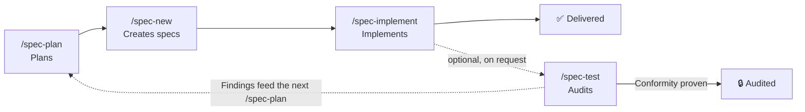

<div align="center">

**🌐 Language:** [Português](../../README.md) | English | [Español](README.es.md) | [简体中文](README.zh-Hans.md) | [हिन्दी](README.hi.md)

</div>

<br/>

<div align="center">
<br/>
<br/>
<p align="center">
  
</p>
<h1>DsCode</h1>

[![][github-license-shield]][github-license-link]
[![][github-stars-shield]][github-stars-link]

**The AI assistant that plans, implements, verifies, and audits code automatically — with zero vendor lock-in.**

<br/>
</div>

**DsCode** is a terminal-based AI coding assistant. You talk to **16 models across DeepSeek V4, OpenAI GPT-5.x, Anthropic Claude, and Google Gemini** — and it analyzes, suggests, reviews, and writes code in your project.

The difference: DsCode is the **only** assistant with a complete Spec-Driven Development (SDD) pipeline. It doesn't just write code — it **plans** what to build, **verifies** quality, **implements** tasks, and **audits** the result. All with automatic correction at each step.

---

## What makes DsCode unique



| Capability           | What it does                                                                       | Why no other tool has it                                                     |
| -------------------- | ---------------------------------------------------------------------------------- | ---------------------------------------------------------------------------- |
| **SDD Pipeline**     | Delivery cycle: plan → create → implement, with optional explicit diagnostic audit | NONSTOP autonomy with deterministic gates — the LLM drafts, the code decides |
| **Multi-provider**   | DeepSeek V4, OpenAI GPT-5.x, Anthropic Claude, Google Gemini                       | Switch providers without changing a single line of configuration             |
| **Skills as agents** | Isolated subagents with their own model, tools, and thinking                       | Each skill runs sandboxed — never pollutes the main context                  |
| **Native MCP**       | Connect databases, browsers, and external APIs                                     | Integrated across all 3 layers: skills, specs, and TUI                       |
| **Steering**         | Persistent rules the AI follows in every session                                   | Granular control: add, list, edit, and remove rules by position              |

---

## How DsCode's SDD works

DsCode's SDD exists to **deliver software**, not to collect formalities. It plans what is needed, implements, validates proportionally and ends with a clear result — even when pendings remain.

**NONSTOP is the normal behaviour.** A failing test, an unfound textual criterion or a document that diverged from the implementation does not, by itself, stop the work: it produces a diagnosis, one bounded correction when actionable, and the flow continues. Stopping is reserved for real impediments — security, permission, integrity, explicit user cancellation or an inability to run safely.

**Proportional validation.** While implementing, the agent runs focused checks and the tests tied to the change. No implementation invocation — `/spec-pipe` or a direct `/spec-implement` — runs the quality bundle, the directed suite or the task's declared commands as a closing step: the recorded fact is `not-applicable`, nothing is postponed and nothing is recovered at the end (ADR-032/ADR-039). Those commands remain available as explicit developer action (CI, pre-push hook) and inside `/spec-test`. To review and repair what was already delivered, use `/spec-stabilize`: it looks for real defects, fixes them and re-evaluates, and never certifies.

**Three terminal results** for `/spec-pipe`:

| Result                    | Meaning                                                                                     |
| ------------------------- | ------------------------------------------------------------------------------------------- |
| `COMPLETED`               | Every task implemented and persisted, nothing pending                                       |
| `COMPLETED_WITH_WARNINGS` | Work delivered, with pendings, omitted checks or unfinished tasks clearly listed            |
| `BLOCKED`                 | Mandatory impediment — security, integrity, permission, cancellation or an unusable runtime |

None of the three depends on `audited`: the result describes the **implementation**. `/spec-pipe` runs `spec-new → spec-implement` and **delivers**; it never runs `/spec-test` automatically. Run `/spec-test <n>` for the independent audit: it is the only authority that grants `audited`, only with proven conformity; when it finds problems, it preserves `implemented` and writes a report `/spec-plan` can consume.

**The pipe does not spend time certifying itself.** `/spec-pipe` runs neither the quality bundle, the directed suite nor the `validationCommands` a task declares: nothing is postponed, so nothing is recovered at the close, and the recorded fact is `not-applicable`. Textual criteria, unproven obligations and documentary contract drift are named pending items in the report: they never veto the delivery nor reopen a completed task. `/spec-test` keeps the rigorous audit; it never repairs code or reopens tasks, and not running it is never reported as an approval.

**One implementation policy.** `/spec-pipe` and a direct `/spec-implement` deliver under the same policy: no functional veto, no automatic certification, no quality bundle as a condition to advance. The invocation chooses orchestration (the pipe also runs `spec-new`), never rigor — same executor, same sealing authority, same durable state. Rigor belongs to `/spec-test`, the exclusive authority for `audited`, which runs only on explicit request.

**Stack agnostic.** Prettier, ESLint, TypeScript and npm are not universal requirements: validators follow the stack actually detected. .NET, Java, Python, Go, Rust, Delphi and others take the same path.

Normative detail: [sdd-base.txt](../../sdd-contrato/sdd-base.txt) and [sdd-fluxo.md](../../sdd-contrato/sdd-fluxo.md).

---

## Quick comparison

|                     | DsCode                     | GitHub Copilot | Cursor      | Claude Code       | Amazon Kiro     |
| ------------------- | -------------------------- | -------------- | ----------- | ----------------- | --------------- |
| **Terminal-native** | ✅ Native TUI              | ❌ IDE only    | ❌ IDE only | ✅ CLI            | ⚠️ IDE + CLI    |
| **Multi-provider**  | ✅ 4 providers             | ❌ GitHub only | ⚠️ Limited  | ❌ Anthropic only | ❌ Bedrock only |
| **SDD Pipeline**    | ✅ Complete + auto-correct | ❌             | ❌          | ❌                | ✅ IDE-based    |
| **Skills/Agents**   | ✅ Isolated subagents      | ❌             | ⚠️ Rules    | ⚠️ Hooks          | ✅ Powers       |
| **Free**            | ✅ No cost                 | ⚠️ Limited     | ⚠️ Limited  | ⚠️ Credits        | ❌ Bedrock cost |

> **Amazon Kiro** is the closest competitor — both have SDD, Steering, and Skills. The difference: DsCode is **terminal-native, multi-provider, and free**; Kiro is **locked to Amazon Bedrock and charges for model usage**.

---

## Install in 30 seconds

Download the binary from the **[releases page](https://github.com/andrelncampos/dscode-public/releases)**. Requires **[Node.js 24+](https://nodejs.org)**.

| System        | File                             |
| ------------- | -------------------------------- |
| Windows (x64) | `dscode-vX.Y.Z-windows-x64.zip`  |
| Linux (x64)   | `dscode-vX.Y.Z-linux-x64.tar.gz` |

Extract and run `./dscode`. DsCode checks for updates automatically on startup.

---

## First use

### 1. Configure your key

Create `~/.dscode/settings.json` with your API key:

```json
{
  "env": {
    "MODEL": "deepseek-v4-pro",
    "BASE_URL": "https://api.deepseek.com",
    "API_KEY": "your-key-here"
  },
  "thinkingEnabled": true
}
```

### 2. Open your project and start

```bash
cd /path/to/your/project
dscode
```

### 3. Take the interactive tour

Type `/quickstart` for a 5-minute tour. The AI demonstrates the full SDD pipeline by building a sample project — you learn by watching it run, not by reading documentation.

Or run `dscode --quickstart` to jump straight into the tour.

---

## What you can do

| Task                     | Type in the prompt                                                   |
| ------------------------ | -------------------------------------------------------------------- |
| **Understand a project** | "Explain this project's architecture in 3 sentences."                |
| **Review code**          | "Review the last commit's changes before I push."                    |
| **Implement a feature**  | "Add email validation to the form in `src/form.ts`."                 |
| **Refactor**             | "Simplify the `processData()` function without changing behavior."   |
| **Investigate a bug**    | "Analyze this stack trace and find the root cause."                  |
| **Create tests**         | "Write unit tests for `validateUser()` in `src/validators.ts`."      |
| **Plan features**        | `/spec-plan` — describe what you want and the AI creates full specs. |
| **Create rules**         | `/steering-add always use TypeScript strict mode`                    |

---

## Essential commands

Type `/` in the prompt to see the full menu. Here are the ones you'll use most:

| Command                                      | Description                                                                                                 |
| -------------------------------------------- | ----------------------------------------------------------------------------------------------------------- |
| `/new`                                       | New conversation — resets context                                                                           |
| `/model`                                     | Switch between 16 models across 4 providers                                                                 |
| `/quickstart`                                | 5-minute interactive SDD pipeline tour                                                                      |
| `/spec-plan`                                 | Plan new features with specs                                                                                |
| `/spec-pipe <n>`                             | SDD delivery: new → implement (no automatic certification)                                                  |
| [`/spec-test`](../spec-test_en.md)           | Independent diagnostic audit of a spec; grants `audited` only on proven conformity                          |
| [`/spec-stabilize`](../spec-stabilize_en.md) | Reviews the delivered implementation, fixes real defects and re-evaluates until stable; **never certifies** |
| `/init`                                      | Create `AGENTS.md` with instructions for the AI                                                             |
| `/steering-add`                              | Add a rule the AI follows in every session                                                                  |
| `/budget`                                    | View project cost by model and timezone                                                                     |
| `/context`                                   | View session tokens, cost, and cache                                                                        |
| `/help`                                      | Full list of commands and keyboard shortcuts                                                                |

> 📋 [Full list of 52 commands](https://github.com/andrelncampos/dscode-public#todos-os-comandos-slash) — including model management, notes, MCP, and skills.

---

## Skills and autonomous agents

Skills are Markdown guides that teach the AI to work in a specific way. DsCode loads skills from 3 sources:

| Location                           | Usage                                                                                                                |
| ---------------------------------- | -------------------------------------------------------------------------------------------------------------------- |
| `templates/skills/` (built-in)     | 6 built-in skills — 3 always loaded (`karpathy-guidelines`, `project-structure`, `sdd-workflow`); the rest on demand |
| `./.dscode/skills/<name>/SKILL.md` | Project skills (highest precedence)                                                                                  |
| `./.agents/skills/<name>/SKILL.md` | Project skills (compatibility)                                                                                       |

Skills can run as **autonomous agents** (`mode: agent`) — each with its own model, tools, and thinking, executing in a sandbox without polluting the main context.

```yaml
# Example: .agents/skills/reviewer/SKILL.md
name: reviewer
description: Reviews code for bugs and improvements
mode: agent
model: deepseek-flash
tools: [read, grep, glob, bash]
```

---

## Security

| Practice                                  | Why                                                          |
| ----------------------------------------- | ------------------------------------------------------------ |
| **Review commands before allowing**       | The AI may suggest `rm`, `sudo`, or network access           |
| **Commit before large tasks**             | `git reset --hard` undoes everything if something goes wrong |
| **Review diffs**                          | DsCode shows every change — the AI can make mistakes         |
| **Never commit `settings.json`**          | It contains your API key (`.gitignore` already excludes it)  |
| **Use a separate branch for experiments** | `git checkout -b ai-experiment` before risky changes         |

---

## License and origin

**DsCode is distributed under the MIT License.** The binaries and other public artifacts may be used, copied, redistributed, modified, sublicensed, and sold without royalties — for personal, academic, professional, or commercial use.

DsCode is closed-source software with executable distributions made available under the MIT License. The source code of DsCode's specific modifications is not part of the public distribution. For this reason, DsCode is not presented as open source software.

**MIT permissions (distributed binaries):**

- ✅ Personal, academic, professional, and commercial use
- ✅ Redistribution and mirroring
- ✅ Sublicensing and resale
- ✅ Inclusion in products and scientific artifacts
- ✅ Benchmarking and publication of results
- ✅ Modification of distributed artifact, where technically possible

This project derives from [DeepCode (lessweb/deepcode-cli)](https://github.com/lessweb/deepcode-cli), originally licensed under MIT. The original copyright notice is preserved in [LICENSE](LICENSE) and [NOTICE](NOTICE). See [THIRD_PARTY_NOTICES.md](THIRD_PARTY_NOTICES.md) for the full list of components and licenses.

---

## Official channels

| Channel      | Link                                                                                                       |
| ------------ | ---------------------------------------------------------------------------------------------------------- |
| **GitHub**   | [github.com/andrelncampos/dscode-public](https://github.com/andrelncampos/dscode-public)                                 |
| **Releases** | [github.com/andrelncampos/dscode-public/releases](https://github.com/andrelncampos/dscode-public/releases) |
| **Issues**   | [github.com/andrelncampos/dscode-public/issues](https://github.com/andrelncampos/dscode-public/issues)                   |

⚠️ Install DsCode **only** from the official channels above. Do not trust versions from third-party sites.

---

<!-- LINK GROUP -->

[github-license-link]: https://github.com/andrelncampos/dscode-public/blob/master/LICENSE
[github-license-shield]: https://img.shields.io/github/license/andrelncampos/dscode?color=4d6BFE&labelColor=black&style=flat-square
[github-stars-link]: https://github.com/andrelncampos/dscode-public/stargazers
[github-stars-shield]: https://img.shields.io/github/stars/andrelncampos/dscode?color=yellow&labelColor=black&style=flat-square
