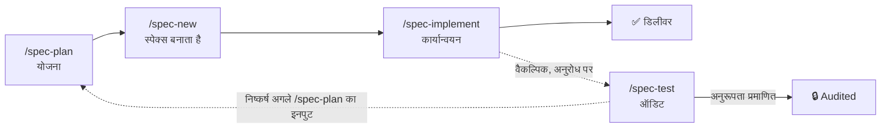

<div align="center">

**🌐 भाषा:** [Português](../../README.md) | [English](README.en.md) | [Español](README.es.md) | [简体中文](README.zh-Hans.md) | हिन्दी

</div>

<br/>

<div align="center">
<br/>
<br/>
<p align="center">
  
</p>
<h1>DsCode</h1>

[![][github-license-shield]][github-license-link]
[![][github-stars-shield]][github-stars-link]

**वह AI सहायक जो कोड की योजना बनाता, लागू करता, सत्यापित करता और ऑडिट करता है — शून्य vendor lock-in के साथ।**

<br/>
</div>

**DsCode** एक टर्मिनल-आधारित AI कोडिंग सहायक है। आप **DeepSeek V4, OpenAI GPT-5.x, Anthropic Claude और Google Gemini के 16 मॉडलों** से बात करते हैं — और यह आपके प्रोजेक्ट में कोड का विश्लेषण, सुझाव, समीक्षा और लेखन करता है।

अंतर: DsCode एकमात्र सहायक है जिसमें संपूर्ण Spec-Driven Development (SDD) पाइपलाइन है। यह सिर्फ कोड नहीं लिखता — यह **योजना बनाता है** कि क्या बनाना है, गुणवत्ता **सत्यापित करता है**, कार्यों को **लागू करता है**, और परिणाम का **ऑडिट करता है**। हर चरण में स्वचालित सुधार के साथ।

---

## DsCode को क्या अनूठा बनाता है



| क्षमता                       | यह क्या करता है                                                                     | कोई अन्य उपकरण क्यों नहीं कर सकता                                                    |
| ---------------------------- | ----------------------------------------------------------------------------------- | ------------------------------------------------------------------------------------ |
| **SDD पाइपलाइन**             | डिलीवरी चक्र: योजना → निर्माण → कार्यान्वयन, वैकल्पिक स्पष्ट निदानात्मक ऑडिट के साथ | NONSTOP स्वायत्तता और नियतात्मक गेट — LLM लिखता है, कोड निर्णय लेता है               |
| **बहु-प्रदाता**              | DeepSeek V4, OpenAI GPT-5.x, Anthropic Claude, Google Gemini                        | बिना एक भी कॉन्फ़िगरेशन लाइन बदले प्रदाता बदलें                                      |
| **एजेंट के रूप में स्किल्स** | अपने मॉडल, टूल्स और thinking के साथ पृथक सब-एजेंट                                   | प्रत्येक स्किल सैंडबॉक्स में चलती है — मुख्य संदर्भ को प्रदूषित नहीं करती            |
| **मूल MCP**                  | डेटाबेस, ब्राउज़र और बाहरी API से जुड़ें                                            | सभी 3 परतों में एकीकृत: स्किल्स, स्पेक्स और TUI                                      |
| **स्टीयरिंग**                | स्थायी नियम जिनका AI हर सत्र में पालन करता है                                       | सूक्ष्म नियंत्रण: स्थिति के अनुसार नियम जोड़ें, सूचीबद्ध करें, संपादित करें और हटाएं |

---

## DsCode का SDD कैसे काम करता है

DsCode का SDD **सॉफ़्टवेयर डिलीवर करने** के लिए है, औपचारिकताएँ जमा करने के लिए नहीं। यह आवश्यक ही योजना बनाता है, लागू करता है, अनुपातिक रूप से जाँचता है और स्पष्ट परिणाम के साथ समाप्त होता है — भले ही कुछ बकाया रह जाए।

**NONSTOP सामान्य व्यवहार है।** एक असफल टेस्ट, एक न मिला पाठ्य मानदंड, या कार्यान्वयन से भिन्न दस्तावेज़ अपने आप काम नहीं रोकते: वे निदान देते हैं, जब संभव हो एक सीमित सुधार करते हैं, और प्रवाह जारी रहता है। रुकना केवल वास्तविक बाधाओं के लिए है — सुरक्षा, अनुमति, अखंडता, उपयोगकर्ता का स्पष्ट रद्दीकरण, या सुरक्षित रूप से चलाने की असंभवता।

**अनुपातिक सत्यापन।** कार्यान्वयन के दौरान एजेंट स्थानीय जाँच और बदलाव से जुड़े टेस्ट चलाता है। स्टैक के quality gates और अंतिम टेस्ट समापन पर **एक बार** चलते हैं, अंतिम स्थिति पर। अंतिम सेट कभी नहीं छोड़ा जाता — और हर कार्य के बाद कभी दोहराया नहीं जाता।

`/spec-pipe` के **तीन अंतिम परिणाम**:

| परिणाम                    | अर्थ                                                                               |
| ------------------------- | ---------------------------------------------------------------------------------- |
| `COMPLETED`               | सभी कार्य लागू और सहेजे गए, कोई बकाया नहीं                                         |
| `COMPLETED_WITH_WARNINGS` | कार्य डिलीवर किया गया, बकाया, छोड़ी गई जाँच या अपूर्ण कार्य स्पष्ट रूप से सूचीबद्ध |
| `BLOCKED`                 | अनिवार्य बाधा — सुरक्षा, अखंडता, अनुमति, रद्दीकरण या अनुपयोगी रनटाइम               |

तीनों में से कोई `audited` पर निर्भर नहीं है: परिणाम **कार्यान्वयन** बताता है। `/spec-pipe` `spec-new → spec-implement` चलाता है और **डिलीवर** करता है; यह `/spec-test` स्वतः कभी नहीं चलाता। स्वतंत्र ऑडिट के लिए `/spec-test <n>` चलाएँ: केवल वही `audited` देता है, और केवल तब जब अनुरूपता प्रमाणित हो; समस्याएँ मिलने पर वह `implemented` बनाए रखता है और ऐसी रिपोर्ट लिखता है जिसे `/spec-plan` उपयोग कर सकता है।

**पाइप स्वयं को प्रमाणित करने में समय नहीं लगाता।** `/spec-pipe` न क्वालिटी बंडल चलाता है, न निर्देशित टेस्ट सूट, और न कार्य द्वारा घोषित `validationCommands`: कुछ भी स्थगित नहीं होता, इसलिए समापन पर कुछ भी पुनर्प्राप्त नहीं होता, और दर्ज तथ्य `not-applicable` होता है। पाठ्य मानदंड, अप्रमाणित दायित्व और दस्तावेज़ी विचलन रिपोर्ट में नामित बकाया बनते हैं: वे डिलीवरी को कभी नहीं रोकते और पूर्ण कार्य को फिर से नहीं खोलते। `/spec-test` कठोर ऑडिट रखता है; वह कोड ठीक नहीं करता और कार्य दोबारा नहीं खोलता; उसे न चलाना कभी स्वीकृति के रूप में नहीं बताया जाता।

**नीति आह्वान पर निर्भर है।** `/spec-pipe` डिलीवर करता है। `/spec-implement` और `/spec-test` जैसे सीधे कमांड अपनी कठोर अर्थ-व्यवस्था बनाए रखते हैं और इसे नहीं अपनाते — वही निष्पादक, वही सीलिंग प्राधिकरण, वही टिकाऊ स्थिति।

**स्टैक-अज्ञेयवादी।** Prettier, ESLint, TypeScript और npm सार्वभौमिक आवश्यकताएँ नहीं हैं: सत्यापनकर्ता वास्तव में पहचाने गए स्टैक के अनुसार चुने जाते हैं।

मानक विवरण: [sdd-base.txt](../../sdd-contrato/sdd-base.txt) और [sdd-fluxo.md](../../sdd-contrato/sdd-fluxo.md)।

---

## त्वरित तुलना

|                   | DsCode                 | GitHub Copilot | Cursor      | Claude Code       | Amazon Kiro     |
| ----------------- | ---------------------- | -------------- | ----------- | ----------------- | --------------- |
| **टर्मिनल-मूल**   | ✅ मूल TUI             | ❌ केवल IDE    | ❌ केवल IDE | ✅ CLI            | ⚠️ IDE + CLI    |
| **बहु-प्रदाता**   | ✅ 4 प्रदाता           | ❌ केवल GitHub | ⚠️ सीमित    | ❌ केवल Anthropic | ❌ केवल Bedrock |
| **SDD पाइपलाइन**  | ✅ पूर्ण + स्वतः सुधार | ❌             | ❌          | ❌                | ✅ IDE-आधारित   |
| **स्किल्स/एजेंट** | ✅ पृथक सब-एजेंट       | ❌             | ⚠️ नियम     | ⚠️ Hooks          | ✅ Powers       |
| **मुफ़्त**        | ✅ कोई लागत नहीं       | ⚠️ सीमित       | ⚠️ सीमित    | ⚠️ क्रेडिट        | ❌ Bedrock लागत |

> **Amazon Kiro** सबसे करीबी प्रतिस्पर्धी है — दोनों में SDD, Steering और Skills हैं। अंतर: DsCode **टर्मिनल-मूल, बहु-प्रदाता और मुफ़्त** है; Kiro **Amazon Bedrock से बंधा है और मॉडल उपयोग के लिए शुल्क लेता है**।

---

## 30 सेकंड में इंस्टॉल करें

**[रिलीज़ पेज](https://github.com/andrelncampos/dscode-public/releases)** से बाइनरी डाउनलोड करें। **[Node.js 24+](https://nodejs.org)** आवश्यक है।

| सिस्टम        | फ़ाइल                            |
| ------------- | -------------------------------- |
| Windows (x64) | `dscode-vX.Y.Z-windows-x64.zip`  |
| Linux (x64)   | `dscode-vX.Y.Z-linux-x64.tar.gz` |

निकालें और `./dscode` चलाएं। DsCode स्टार्टअप पर स्वचालित रूप से अपडेट की जांच करता है।

---

## पहला उपयोग

### 1. अपनी कुंजी कॉन्फ़िगर करें

अपनी API कुंजी के साथ `~/.dscode/settings.json` बनाएं:

```json
{
  "env": {
    "MODEL": "deepseek-v4-pro",
    "BASE_URL": "https://api.deepseek.com",
    "API_KEY": "आपकी-कुंजी-यहां"
  },
  "thinkingEnabled": true
}
```

### 2. अपना प्रोजेक्ट खोलें और शुरू करें

```bash
cd /आपके/प्रोजेक्ट/का/पथ
dscode
```

### 3. इंटरैक्टिव टूर लें

5 मिनट के टूर के लिए `/quickstart` टाइप करें। AI एक नमूना प्रोजेक्ट बनाकर पूर्ण SDD पाइपलाइन का प्रदर्शन करता है — आप इसे चलते हुए देखकर सीखते हैं, दस्तावेज़ पढ़कर नहीं।

या सीधे टूर में जाने के लिए `dscode --quickstart` चलाएं।

---

## आप क्या कर सकते हैं

| कार्य                 | प्रॉम्प्ट में टाइप करें                                               |
| --------------------- | --------------------------------------------------------------------- |
| **प्रोजेक्ट समझें**   | "इस प्रोजेक्ट की आर्किटेक्चर 3 वाक्यों में समझाएं।"                   |
| **कोड समीक्षा**       | "पुश करने से पहले अंतिम कमिट के बदलावों की समीक्षा करें।"             |
| **सुविधा लागू करें**  | "`src/form.ts` में फॉर्म में ईमेल सत्यापन जोड़ें।"                    |
| **रीफैक्टर**          | "`processData()` फ़ंक्शन को बिना व्यवहार बदले सरल बनाएं।"             |
| **बग जांच**           | "इस स्टैक ट्रेस का विश्लेषण करें और मूल कारण खोजें।"                  |
| **टेस्ट बनाएं**       | "`src/validators.ts` में `validateUser()` के लिए यूनिट टेस्ट लिखें।"  |
| **सुविधाओं की योजना** | `/spec-plan` — बताएं कि आपको क्या चाहिए और AI पूर्ण स्पेक्स बनाता है। |
| **नियम बनाएं**        | `/steering-add हमेशा TypeScript स्ट्रिक्ट मोड का उपयोग करें`          |

---

## आवश्यक कमांड

पूर्ण मेनू देखने के लिए प्रॉम्प्ट में `/` टाइप करें। ये वे हैं जिनका आप सबसे अधिक उपयोग करेंगे:

| कमांड                              | विवरण                                                                             |
| ---------------------------------- | --------------------------------------------------------------------------------- |
| `/new`                             | नई बातचीत — संदर्भ रीसेट करता है                                                  |
| `/model`                           | 4 प्रदाताओं के 16 मॉडलों के बीच स्विच करें                                        |
| `/quickstart`                      | 5 मिनट का इंटरैक्टिव SDD पाइपलाइन टूर                                             |
| `/spec-plan`                       | स्पेक्स के साथ नई सुविधाओं की योजना बनाएं                                         |
| `/spec-pipe <n>`                   | SDD डिलीवरी: new → implement (स्वचालित प्रमाणन नहीं)                              |
| [`/spec-test`](../spec-test_en.md) | स्पेक का स्वतंत्र निदानात्मक ऑडिट; अनुरूपता प्रमाणित होने पर ही `audited` देता है |
| `/init`                            | AI के लिए निर्देशों के साथ `AGENTS.md` बनाएं                                      |
| `/steering-add`                    | एक नियम जोड़ें जिसका AI हर सत्र में पालन करे                                      |
| `/budget`                          | मॉडल और समय क्षेत्र के अनुसार परियोजना लागत देखें                                 |
| `/context`                         | सत्र के टोकन, लागत और कैश देखें                                                   |
| `/help`                            | कमांड और कीबोर्ड शॉर्टकट की पूरी सूची                                             |

> 📋 [52 कमांड की पूरी सूची](https://github.com/andrelncampos/dscode-public#todos-os-comandos-slash) — मॉडल प्रबंधन, नोट्स, MCP और स्किल्स सहित।

---

## स्किल्स और स्वायत्त एजेंट

स्किल्स Markdown गाइड हैं जो AI को एक विशिष्ट तरीके से काम करना सिखाती हैं। DsCode 3 स्रोतों से स्किल्स लोड करता है:

| स्थान                             | उपयोग                                                                                                                  |
| --------------------------------- | ---------------------------------------------------------------------------------------------------------------------- |
| `templates/skills/` (अंतर्निहित)  | 6 अंतर्निहित स्किल्स — 3 हमेशा लोड होती हैं (`karpathy-guidelines`, `project-structure`, `sdd-workflow`); बाकी मांग पर |
| `./.dscode/skills/<नाम>/SKILL.md` | प्रोजेक्ट स्किल्स (सर्वोच्च प्राथमिकता)                                                                                |
| `./.agents/skills/<नाम>/SKILL.md` | प्रोजेक्ट स्किल्स (संगतता)                                                                                             |

स्किल्स **स्वायत्त एजेंट** (`mode: agent`) के रूप में चल सकती हैं — प्रत्येक अपने मॉडल, टूल्स और thinking के साथ, मुख्य संदर्भ को प्रदूषित किए बिना सैंडबॉक्स में निष्पादित होती हैं।

```yaml
# उदाहरण: .agents/skills/reviewer/SKILL.md
name: reviewer
description: बग और सुधार के लिए कोड की समीक्षा करता है
mode: agent
model: deepseek-flash
tools: [read, grep, glob, bash]
```

---

## सुरक्षा

| अभ्यास                                        | क्यों                                                        |
| --------------------------------------------- | ------------------------------------------------------------ |
| **अनुमति देने से पहले कमांड की समीक्षा करें** | AI `rm`, `sudo` या नेटवर्क एक्सेस का सुझाव दे सकता है        |
| **बड़े कार्यों से पहले कमिट करें**            | कुछ गलत होने पर `git reset --hard` सब कुछ पूर्ववत कर देता है |
| **डिफ की समीक्षा करें**                       | DsCode हर बदलाव दिखाता है — AI गलतियाँ कर सकता है            |
| **`settings.json` कभी कमिट न करें**           | इसमें आपकी API कुंजी है (`.gitignore` पहले से बाहर रखता है)  |
| **प्रयोगों के लिए अलग ब्रांच का उपयोग करें**  | जोखिम भरे बदलावों से पहले `git checkout -b ai-experiment`    |

---

## लाइसेंस और उत्पत्ति

**DsCode MIT लाइसेंस के तहत वितरित किया जाता है।** बाइनरी और अन्य सार्वजनिक आर्टिफ़ैक्ट बिना रॉयल्टी के उपयोग, कॉपी, पुनर्वितरित, संशोधित, उप-लाइसेंस और बेचे जा सकते हैं — व्यक्तिगत, शैक्षणिक, व्यावसायिक या वाणिज्यिक उपयोग के लिए।

DsCode एक बंद-स्रोत सॉफ़्टवेयर है जिसकी एक्जीक्यूटेबल वितरण MIT लाइसेंस के तहत उपलब्ध हैं। DsCode के विशिष्ट संशोधनों का स्रोत कोड सार्वजनिक वितरण का हिस्सा नहीं है। इस कारण DsCode को ओपन सोर्स सॉफ़्टवेयर के रूप में प्रस्तुत नहीं किया जाता।

यह प्रोजेक्ट [DeepCode (lessweb/deepcode-cli)](https://github.com/lessweb/deepcode-cli) से व्युत्पन्न है, जो मूल रूप से MIT लाइसेंस के तहत है। मूल कॉपीराइट नोटिस [LICENSE](LICENSE) और [NOTICE](NOTICE) में संरक्षित है। घटकों और लाइसेंस की पूरी सूची के लिए [THIRD_PARTY_NOTICES.md](THIRD_PARTY_NOTICES.md) देखें।

---

## आधिकारिक चैनल

| चैनल        | लिंक                                                                                                       |
| ----------- | ---------------------------------------------------------------------------------------------------------- |
| **GitHub**  | [github.com/andrelncampos/dscode-public](https://github.com/andrelncampos/dscode-public)                                 |
| **रिलीज़**  | [github.com/andrelncampos/dscode-public/releases](https://github.com/andrelncampos/dscode-public/releases) |
| **इश्यूज़** | [github.com/andrelncampos/dscode-public/issues](https://github.com/andrelncampos/dscode-public/issues)                   |

⚠️ DsCode को **केवल** उपरोक्त आधिकारिक चैनलों से इंस्टॉल करें। तृतीय-पक्ष साइटों के संस्करणों पर भरोसा न करें।

---

<!-- LINK GROUP -->

[github-license-link]: https://github.com/andrelncampos/dscode-public/blob/master/LICENSE
[github-license-shield]: https://img.shields.io/github/license/andrelncampos/dscode?color=4d6BFE&labelColor=black&style=flat-square
[github-stars-link]: https://github.com/andrelncampos/dscode-public/stargazers
[github-stars-shield]: https://img.shields.io/github/stars/andrelncampos/dscode?color=yellow&labelColor=black&style=flat-square
